# Các mô hình học sâu cho FloodAI từ nguyên lý đến mô phỏng

Tác giả: Trần Nguyên Hoàng · 27/10/2026

Tìm hiểu 26 mô hình và phương pháp cho dự báo lũ qua công thức, lưu đồ, kiến trúc mạng, bảng cấu hình và video mô phỏng từng bước.

Cấu hình minh họa; mô phỏng dùng dữ liệu giả lập.

## 2.1 Huấn luyện mô hình học sâu

Quy trình dùng chung cho các mạng trong tài liệu

Đầu vào: dữ liệu đã chia theo sự kiện và thời gian. Đầu ra: mô hình tốt nhất theo tập validation.

Kiến trúc mạng quyết định cách tạo dự báo. Lan truyền ngược và bộ tối ưu như Adam quyết định cách điều chỉnh trọng số. Test chỉ được sử dụng sau khi đã chốt mô hình.

**Kiến trúc:** Dữ liệu → dự báo → hàm mất mát → gradient → cập nhật tham số.

$$
\theta \leftarrow \theta-\eta\nabla_{\theta}\mathcal{L}
$$

1. Chia train validation và test theo thời gian hoặc sự kiện.
2. Chuẩn hóa bằng thống kê train và tạo cửa sổ nhân quả.
3. Khởi tạo tham số và bộ tối ưu.
4. Lấy mini batch và chạy lan truyền thuận.
5. Tính loss có xét mặt nạ nhãn.
6. Lan truyền ngược và cập nhật tham số.
7. Đánh giá validation và lưu checkpoint tốt nhất.

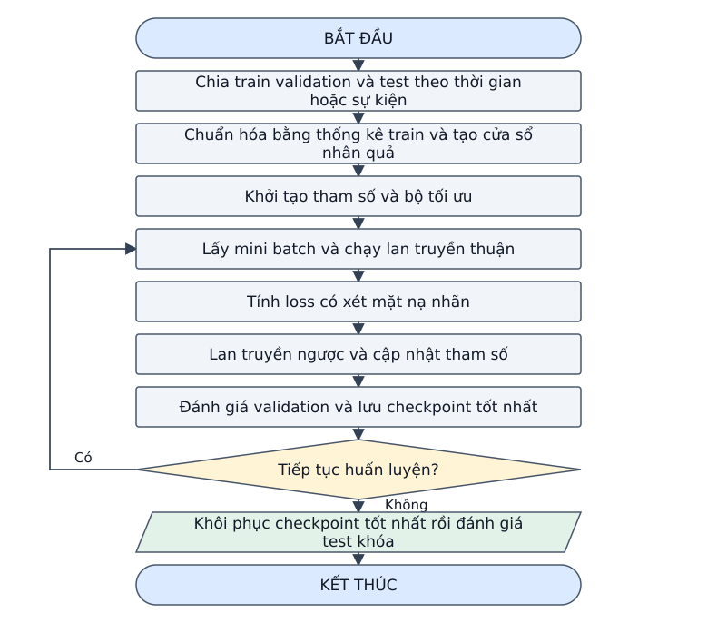

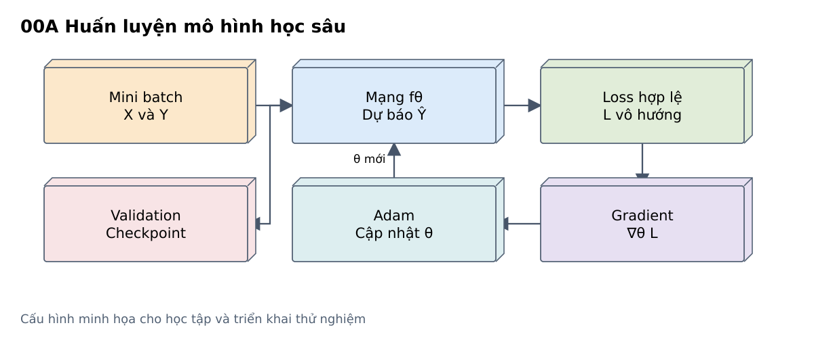

| Khối hoặc lớp | Cấu hình minh họa | Đầu ra |
|---|---|---|
| Chia dữ liệu | Theo thời gian hoặc sự kiện | Train / val / test |
| Chuẩn hóa | Fit bằng train; áp dụng val/test | X cùng kích thước |
| Mini batch | B = 32; L = 24; F = 6 | X: B × 24 × 6 |
| Backbone và head | GRU 32; Dense 6 | Ŷ: B × 6 |
| Loss | Chỉ nhãn hợp lệ; bỏ batch rỗng | Một số vô hướng |
| Adam | Learning rate minh họa 0,001 | Tham số θ mới |
| Validation | Lưu checkpoint tốt nhất; early stop | Mô hình đã chọn |

Sơ đồ minh họa một vòng huấn luyện. Sau khi chọn checkpoint mới đánh giá test; không dùng test để chọn mô hình.

[Mô phỏng MP4](../assets/video/00_Huan_luyen_chung.mp4)

**Lưu ý:** Công thức minh họa bước gradient descent; Adam sử dụng thêm các ước lượng mômen. Dừng theo số epoch hoặc early stopping; khôi phục checkpoint tốt nhất trước khi đánh giá test.

Nguồn: [1]

## 2.2 MLP

Bộ mã hóa đặc trưng tĩnh

Đầu vào: độ cao, độ dốc, diện tích và mã loại đất. Đầu ra: vector đặc trưng lưu vực.

MLP học quan hệ phi tuyến giữa các đặc trưng. Biến phân loại được mã hóa bằng embedding hoặc cách biểu diễn phù hợp trước khi ghép với biến liên tục.

**Kiến trúc:** Vector đặc trưng → các lớp Dense và kích hoạt → vector biểu diễn.

$$
h^{(l+1)}=\phi(W^{(l)}h^{(l)}+b^{(l)})
$$

1. Nhận đặc trưng tĩnh đã chuẩn hóa.
2. Mã hóa biến phân loại và ghép đặc trưng.
3. Tính phép biến đổi tuyến tính của lớp.
4. Áp dụng hàm kích hoạt.
5. Chuyển qua lớp kế tiếp.

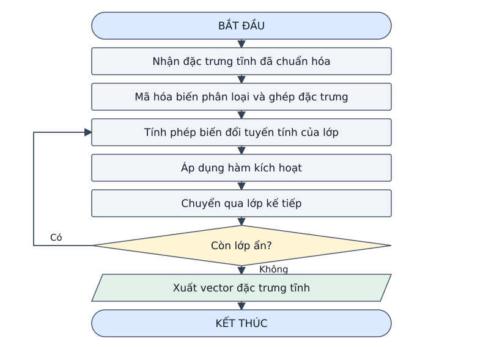

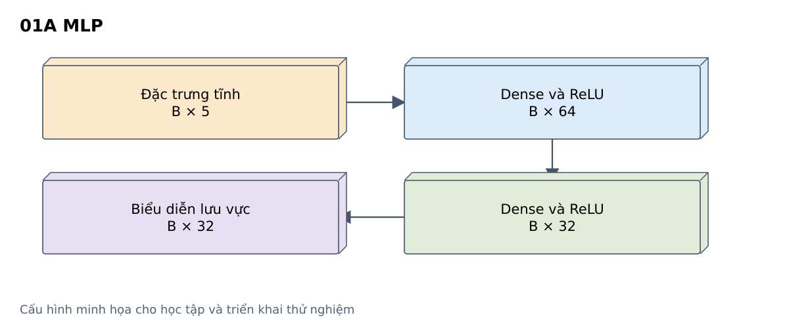

| Khối hoặc lớp | Cấu hình minh họa | Đầu ra |
|---|---|---|
| Đầu vào | 5 biến số đã chuẩn hóa | B × 5 |
| Dense 1 | 5 → 64; ReLU | B × 64 |
| Dense 2 | 64 → 32; ReLU | B × 32 |
| Đầu ra encoder | D = 32 | B × 32 |

Ví dụ dùng 5 biến liên tục. Nếu có loại đất hoặc lớp phủ dạng phân loại, thêm embedding trước khi ghép vector.

[Mô phỏng MP4](../assets/video/01_MLP.mp4)

**Lưu ý:** Không có bộ nhớ thời gian hay cấu trúc mạng sông mặc định. Trong đề cương, MLP chủ yếu là một nhánh encoder, không phải toàn bộ mô hình dự báo.

Nguồn: [1]

## 2.3 CNN

Bộ mã hóa ảnh radar hoặc vệ tinh

Đầu vào: ảnh dạng lưới, có thể nhiều kênh. Đầu ra: bản đồ hoặc vector đặc trưng.

Bộ lọc dùng chung trọng số quét qua ảnh để phát hiện các mẫu cục bộ. Các lớp sâu hơn kết hợp chúng thành cấu trúc lớn hơn như hình dạng và phân bố vùng mưa.

**Kiến trúc:** Ảnh → tích chập và kích hoạt → tổng hợp không gian → đặc trưng.

$$
F_{ij}=\phi\left(\sum_{u,v}K_{uv}X_{i+u,j+v}+b\right)
$$

1. Nhận ảnh và mặt nạ vùng hợp lệ.
2. Áp dụng các bộ lọc tích chập.
3. Áp dụng kích hoạt và chuẩn hóa nếu dùng.
4. Lặp khối tích chập hoặc giảm mẫu.
5. Tổng hợp bản đồ thành vector khi cần.

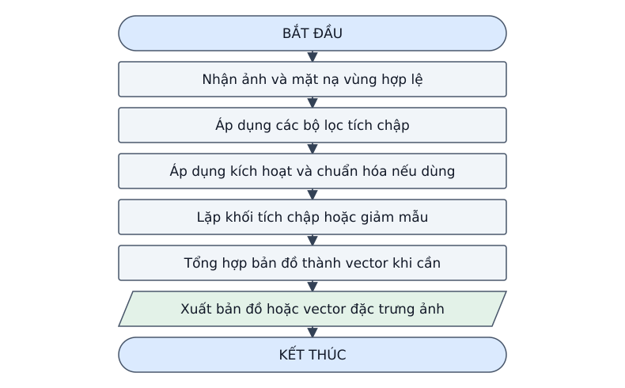

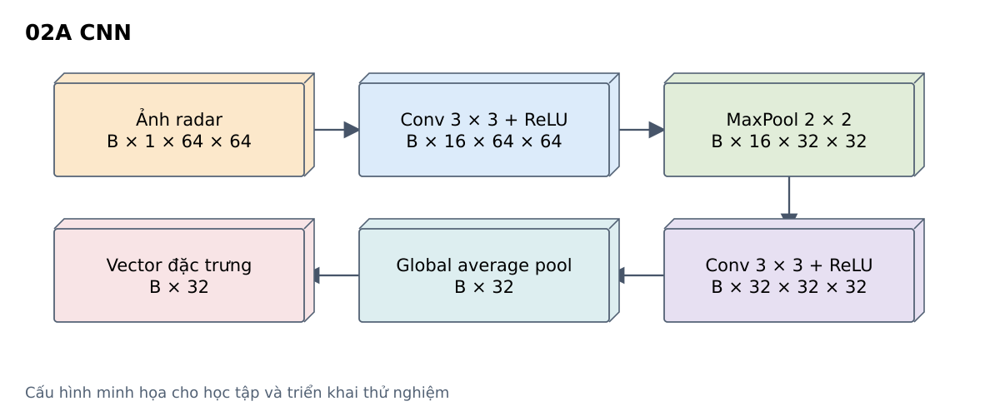

| Khối hoặc lớp | Cấu hình minh họa | Đầu ra |
|---|---|---|
| Ảnh đầu vào | 1 kênh; 64 × 64 điểm ảnh | B × 1 × 64 × 64 |
| Conv2d + ReLU | 16 lọc; k = 3; s = 1; p = 1 | B × 16 × 64 × 64 |
| MaxPool2d | k = 2; s = 2 | B × 16 × 32 × 32 |
| Conv2d + ReLU | 32 lọc; k = 3; s = 1; p = 1 | B × 32 × 32 × 32 |
| Global average pool | Trung bình trên hai chiều ảnh | B × 32 |
| Đầu ra encoder | Không có softmax phân lớp | B × 32 |

Đây là CNN mã hóa ảnh cho FloodAI. Không sử dụng đầu phát hiện vật thể hay các lớp Darknet trong hình mẫu.

[Mô phỏng MP4](../assets/video/02_CNN.mp4)

**Lưu ý:** Công thức minh họa một bộ lọc một kênh. CNN 2D xử lý từng ảnh riêng lẻ chưa tự học sự dịch chuyển theo thời gian; cần kết hợp mô đun thời gian hoặc dùng ConvLSTM.

Nguồn: [1, 2]

## 2.4 TCN

Mô hình nền và encoder chuỗi thời gian

Đầu vào: lịch sử mưa, Q hoặc H. Đầu ra: biểu diễn chuỗi hoặc dự báo nhiều bước.

Tích chập nhân quả tránh nhìn vào tương lai. Độ giãn cách tăng theo lớp giúp mở rộng vùng quá khứ được sử dụng; kết nối dư giúp tối ưu mạng sâu.

**Kiến trúc:** Chuỗi → các khối tích chập nhân quả giãn cách và kết nối dư → đầu ra.

$$
h_t=\phi\left(\sum_{k=0}^{K-1}W_kx_{t-dk}+b\right)
$$

1. Nhận cửa sổ quan trắc kết thúc tại thời điểm phát báo.
2. Đặt mức giãn cách cho khối hiện tại.
3. Tích chập nhân quả và áp dụng kích hoạt.
4. Kết hợp nhánh dư có cùng kích thước.
5. Tăng mức giãn cách và chuyển sang khối tiếp.

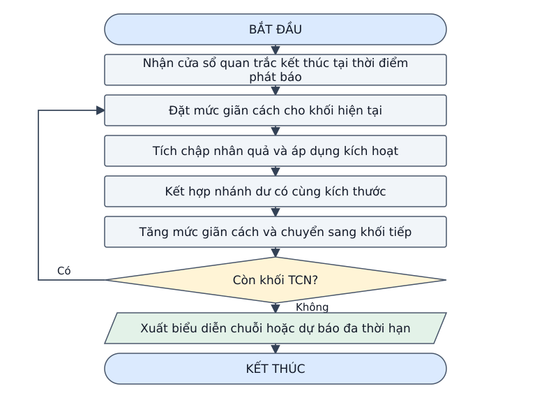

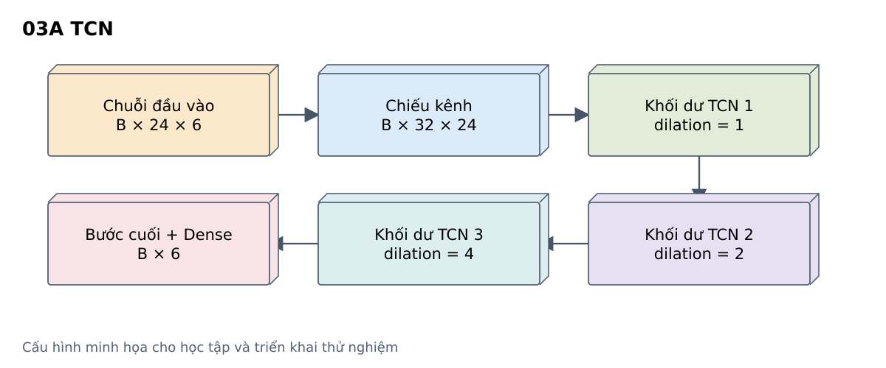

| Khối hoặc lớp | Cấu hình minh họa | Đầu ra |
|---|---|---|
| Đầu vào và đổi trục | L = 24; F = 6 | B × 6 × 24 |
| Chiếu kênh | Conv1d 1 × 1; 6 → 32 | B × 32 × 24 |
| Khối dư 1 | 2 causal conv; k = 3; d = 1 | B × 32 × 24 |
| Khối dư 2 | 2 causal conv; k = 3; d = 2 | B × 32 × 24 |
| Khối dư 3 | 2 causal conv; k = 3; d = 4 | B × 32 × 24 |
| Lấy bước cuối | Receptive field = 29 bước | B × 32 |
| Head dự báo | Dense 32 → 6 | B × 6 |

Mỗi khối có hai tích chập nhân quả và nhánh cộng dư. Receptive field = 1 + 2(3 − 1)(1 + 2 + 4) = 29; cửa sổ 24 chỉ chứa 24 quan trắc thật.

[Mô phỏng MP4](../assets/video/03_TCN.mp4)

**Lưu ý:** Độ dài phụ thuộc học được bị giới hạn bởi receptive field. Cần chọn số lớp, kích thước kernel và dilation theo lịch sử cần quan sát; mọi đầu vào đều phải sẵn có tại thời điểm dự báo.

Nguồn: [1, 3]

## 2.5 GRU

Mô hình nền và encoder trạng thái mưa lũ

Đầu vào: chuỗi vector quan trắc. Đầu ra: trạng thái ẩn và dự báo.

Reset gate điều khiển mức sử dụng trạng thái cũ khi tạo ứng viên. Update gate điều khiển mức kết hợp thông tin cũ và mới. Trạng thái được truyền qua các bước thời gian.

**Kiến trúc:** Dữ liệu hiện tại và trạng thái cũ → reset gate và update gate → trạng thái mới.

$$
h_t=(1-z_t)\odot h_{t-1}+z_t\odot\widetilde{h}_t
$$

1. Khởi tạo trạng thái ẩn và chỉ số thời gian.
2. Đọc dữ liệu tại bước hiện tại.
3. Tính reset gate và update gate.
4. Tính trạng thái ứng viên từ dữ liệu và trạng thái cũ.
5. Trộn trạng thái cũ với ứng viên.
6. Tăng chỉ số thời gian.

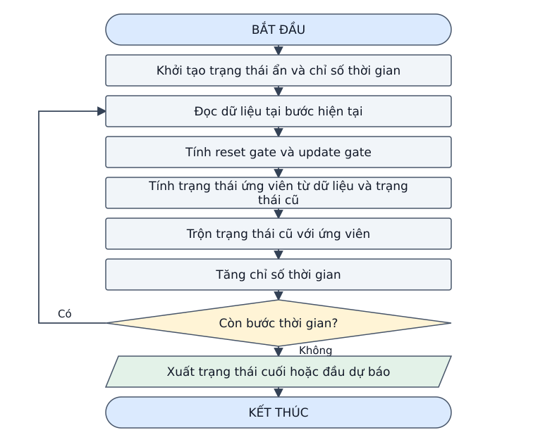

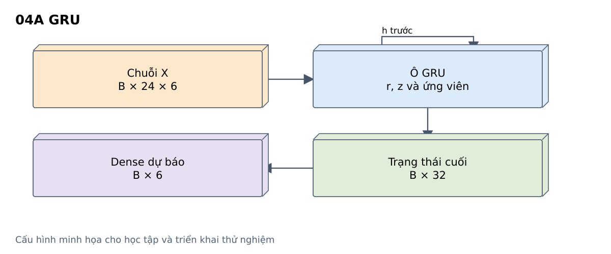

| Khối hoặc lớp | Cấu hình minh họa | Đầu ra |
|---|---|---|
| Chuỗi đầu vào | L = 24; F = 6 | B × 24 × 6 |
| Trạng thái khởi tạo | h₀ = 0; D = 32 | B × 32 |
| Ô GRU | 1 tầng; hidden size = 32 | B × 24 × 32 |
| Lấy h cuối | h tại bước 24 | B × 32 |
| Head dự báo | Dense 32 → 6 | B × 6 |

Mũi tên hồi tiếp biểu thị h từ bước trước. Reset gate và update gate đều có 32 phần tử cho mỗi mẫu.

[Mô phỏng MP4](../assets/video/04_GRU.mp4)

**Lưu ý:** Dùng quy ước update gate nhân với ứng viên; một số thư viện dùng quy ước ngược. Khi triển khai cần giữ nhất quán công thức. GRU học trạng thái thống kê, không mặc nhiên là một đại lượng thủy văn.

Nguồn: [1, 4]

## 2.6 LSTM

Mô hình nền và encoder chuỗi mưa dòng chảy

Đầu vào: chuỗi quan trắc và trạng thái khởi tạo. Đầu ra: ô nhớ, trạng thái ẩn và dự báo.

Forget gate giữ hoặc giảm thông tin trong ô nhớ cũ. Input gate chọn thông tin được ghi vào ô nhớ. Output gate chọn phần thông tin ô nhớ được biểu diễn ở trạng thái ẩn.

**Kiến trúc:** Dữ liệu và hai trạng thái cũ → ba cổng → cập nhật ô nhớ và trạng thái ẩn.

$$
c_t=f_t\odot c_{t-1}+i_t\odot\widetilde{c}_t,\quad h_t=o_t\odot\tanh(c_t)
$$

1. Khởi tạo trạng thái ẩn h và ô nhớ c.
2. Đọc dữ liệu tại bước hiện tại.
3. Tính các cổng quên vào ra và ô nhớ ứng viên.
4. Cập nhật ô nhớ bằng thông tin cũ và thông tin mới.
5. Tính trạng thái ẩn từ ô nhớ mới.
6. Tăng chỉ số thời gian.

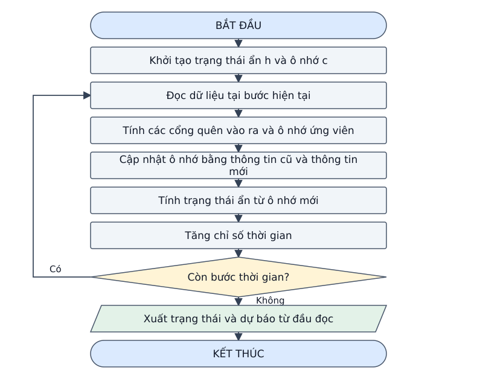

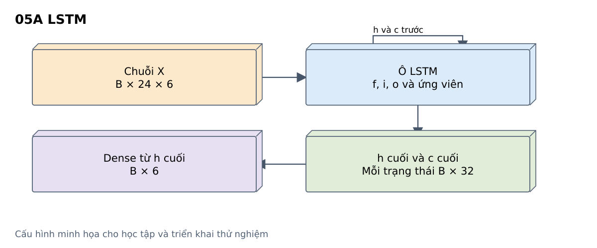

| Khối hoặc lớp | Cấu hình minh họa | Đầu ra |
|---|---|---|
| Chuỗi đầu vào | L = 24; F = 6 | B × 24 × 6 |
| Khởi tạo h₀ và c₀ | Hai trạng thái 32 chiều | Mỗi trạng thái B × 32 |
| Ô LSTM | 1 tầng; hidden size = 32 | B × 24 × 32 |
| Trạng thái cuối | Head nhận h; c giữ nội bộ | B × 32 |
| Head dự báo | Dense 32 → 6 | B × 6 |

Từng cổng và ô nhớ ứng viên có 32 phần tử. Ô nhớ c không được tự diễn giải là trữ lượng nước.

[Mô phỏng MP4](../assets/video/05_LSTM.mp4)

**Lưu ý:** Ô nhớ có thể nắm bắt ảnh hưởng tích lũy của mưa. Không diễn giải trực tiếp ô nhớ thành độ ẩm đất hoặc lượng nước trữ nếu chưa có bằng chứng kiểm chứng.

Nguồn: [1, 5]

## 2.7 GRU D

Mô hình được dẫn trong tổng quan về dữ liệu thiếu

Đầu vào: giá trị, mặt nạ có thiếu, thời gian từ lần đo gần nhất. Đầu ra: biểu diễn chuỗi chịu thiếu.

GRU D học cách giảm ảnh hưởng của quan trắc và trạng thái cũ khi khoảng thiếu kéo dài. Giá trị thay thế kết hợp lần đo gần nhất với trung bình của biến tính trên train.

**Kiến trúc:** Quan trắc và metadata thiếu → decay đầu vào và trạng thái → ô GRU.

$$
x_t^*=m_tx_t+(1-m_t)[\gamma_tx_{last}+(1-\gamma_t)\bar{x}]
$$

1. Khởi tạo trạng thái và giá trị quan trắc gần nhất.
2. Đọc giá trị mặt nạ và khoảng thời gian thiếu.
3. Tính hệ số decay cho đầu vào và trạng thái.
4. Giữ giá trị hợp lệ hoặc tạo giá trị thay thế bằng decay.
5. Cập nhật trạng thái GRU có xét mặt nạ.
6. Cập nhật lịch sử quan trắc và tăng thời gian.

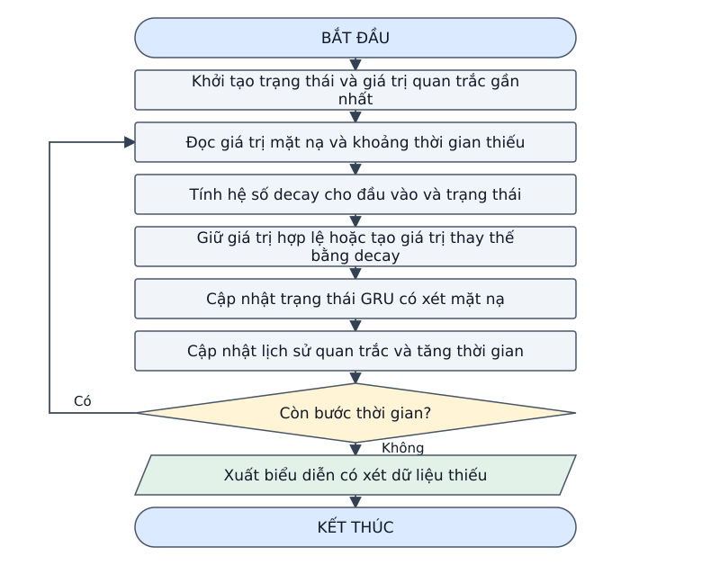

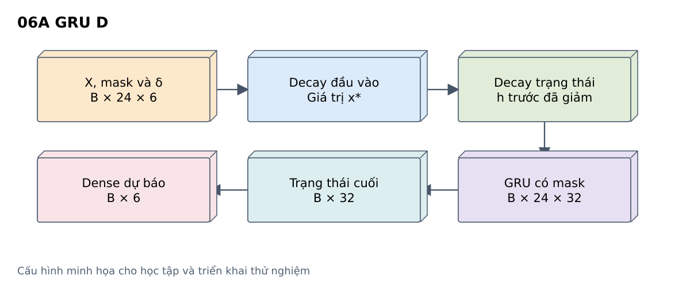

| Khối hoặc lớp | Cấu hình minh họa | Đầu ra |
|---|---|---|
| Đầu vào X, M, δ | M = 1 nếu có quan trắc | Mỗi tensor B × 24 × 6 |
| Mean và last value | Mean fit trên train | 6 giá trị / mẫu |
| Decay đầu vào | γx theo δ; thay giá trị thiếu | B × 24 × 6 |
| Decay trạng thái | γh theo δ; 32 chiều | B × 32 mỗi bước |
| GRU có mask | hidden size = 32; 24 bước | B × 24 × 32 |
| Lấy cuối và Dense | 32 → 6 | B × 6 |

Đây là cấu hình minh họa theo nguyên lý GRU-D; triển khai cần giữ decay đầu vào, decay trạng thái và mask đúng theo mô hình gốc.

[Mô phỏng MP4](../assets/video/06_GRU_D.mp4)

**Lưu ý:** Công thức minh họa một biến. GRU D gốc còn có decay trạng thái ẩn. Đây là cơ sở tham khảo cho mask aware encoder; không đồng nghĩa đề cương đã chốt dùng GRU D.

Nguồn: [1, 6]

## 2.8 ConvLSTM

Encoder chuỗi ảnh radar hoặc vệ tinh

Đầu vào: chuỗi ảnh có cấu trúc không gian. Đầu ra: bản đồ trạng thái không gian thời gian.

Thay phép biến đổi kết nối đầy đủ của LSTM bằng tích chập. Trạng thái ẩn và ô nhớ giữ dạng bản đồ, giúp học đồng thời vị trí và diễn biến vùng mưa.

**Kiến trúc:** Chuỗi ảnh → các ô LSTM dùng tích chập → đặc trưng không gian thời gian.

$$
f_t=\sigma(W_{xf}*X_t+W_{hf}*H_{t-1}+b_f)
$$

1. Khởi tạo bản đồ trạng thái và ô nhớ.
2. Đọc ảnh tại thời điểm hiện tại.
3. Tích chập ảnh và trạng thái để tính các cổng.
4. Tính bản đồ ô nhớ ứng viên.
5. Cập nhật bản đồ ô nhớ và trạng thái ẩn.
6. Chuyển sang ảnh tiếp theo.

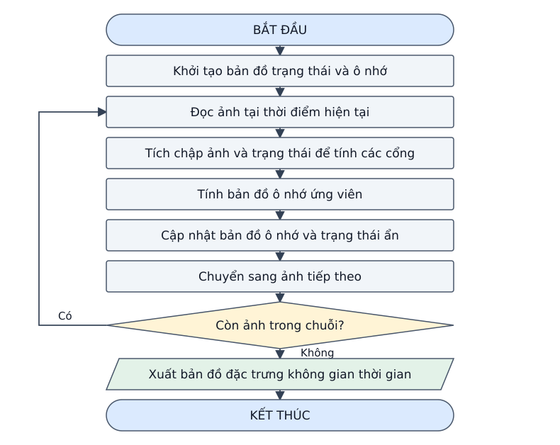

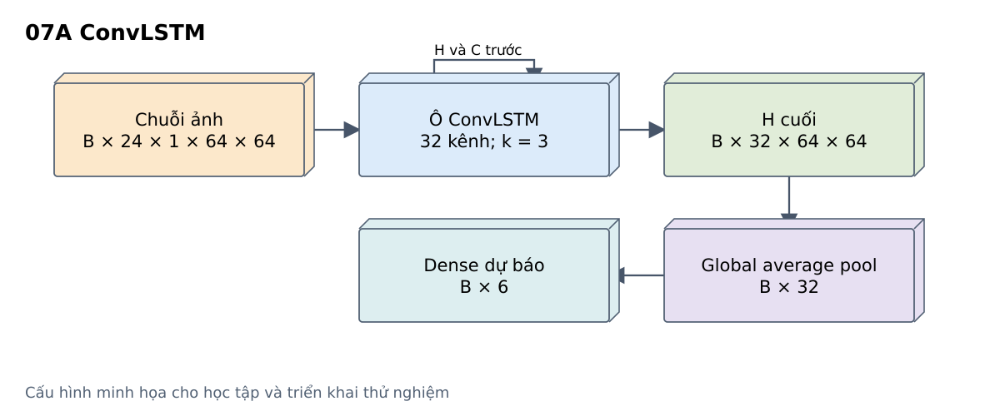

| Khối hoặc lớp | Cấu hình minh họa | Đầu ra |
|---|---|---|
| Chuỗi ảnh | 24 ảnh; 1 kênh; 64 × 64 | B × 24 × 1 × 64 × 64 |
| Khởi tạo H và C | 32 kênh; lưới 64 × 64 | B × 32 × 64 × 64 |
| ConvLSTM cell | k = 3; s = 1; p = 1 | B × 32 × 64 × 64 / bước |
| Trạng thái H cuối | Sau ảnh thứ 24 | B × 32 × 64 × 64 |
| Global average pool | Trung bình theo hai trục ảnh | B × 32 |
| Head dự báo | Dense 32 → 6 | B × 6 |

Cấu hình đơn tầng, giữ độ phân giải ảnh. H trong ô nhớ là trạng thái mạng; đầu dự báo minh họa cho một vùng đã chọn.

[Mô phỏng MP4](../assets/video/07_ConvLSTM.mp4)

**Lưu ý:** Công thức là dạng giản lược, không biểu diễn peephole. Dấu sao là tích chập; H ở công thức này là trạng thái ẩn, không phải mực nước. Có thể tổng hợp bản đồ để đưa vào mô hình dự báo Q và H.

Nguồn: [1, 7]

## 2.9 GCN

Phương án tổng hợp thông tin trên đồ thị

Đầu vào: đặc trưng các nút và ma trận kề. Đầu ra: biểu diễn nút có thông tin lân cận.

Mỗi lớp kết hợp thông tin nút với các nút lân cận. Chuẩn hóa theo bậc giúp điều tiết mức đóng góp. Qua nhiều lớp, phạm vi thu nhận thông tin được mở rộng.

**Kiến trúc:** Đặc trưng nút và đồ thị → chuẩn hóa kết nối → tổng hợp lân cận → biểu diễn mới.

$$
H^{(l+1)}=\phi(\widetilde{D}^{-1/2}\widetilde{A}\widetilde{D}^{-1/2}H^{(l)}W^{(l)})
$$

1. Nhận ma trận đặc trưng nút và ma trận kề.
2. Thêm self loop và tính ma trận bậc.
3. Chuẩn hóa ma trận kề.
4. Tổng hợp lân cận và nhân ma trận trọng số.
5. Áp dụng kích hoạt và chuyển lớp.

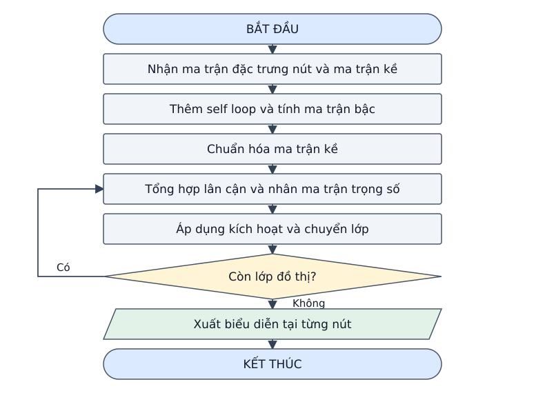

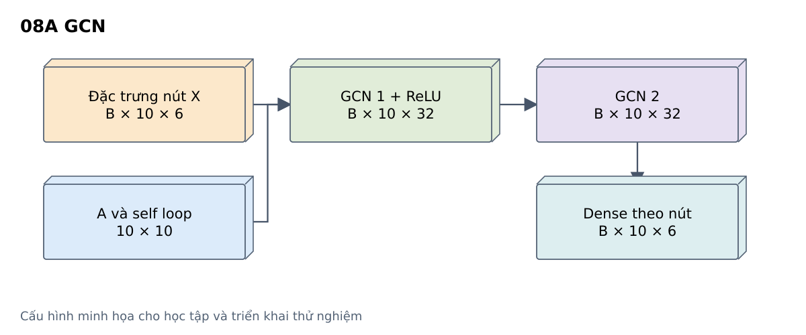

| Khối hoặc lớp | Cấu hình minh họa | Đầu ra |
|---|---|---|
| Đặc trưng đầu vào | N = 10; F = 6 | B × 10 × 6 |
| Đồ thị không hướng | A cộng I; chuẩn hóa đối xứng | 10 × 10 |
| GCN 1 + ReLU | 6 → 32 | B × 10 × 32 |
| GCN 2 | 32 → 32 | B × 10 × 32 |
| Head theo nút | Dense dùng chung 32 → 6 | B × 10 × 6 |

GCN này nhận một lát thời gian để minh họa phép toán đồ thị. Dự báo động lực học cần encoder thời gian; đồ thị có hướng cần biến thể khác.

[Mô phỏng MP4](../assets/video/08_GCN.mp4)

**Lưu ý:** Đây là GCN chuẩn cho đồ thị không hướng. Giữ hướng thượng lưu đến hạ lưu cần biến thể phù hợp. H là ma trận trạng thái nút; không phải ký hiệu mực nước ở công thức này.

Nguồn: [1, 8]

## 2.10 GraphSAGE

Phương án đồ thị có khả năng áp dụng cho nút mới

Đầu vào: đặc trưng nút và lân cận. Đầu ra: embedding nút từ hàm tổng hợp dùng chung.

GraphSAGE học hàm tạo embedding từ đặc trưng và lân cận thay vì học riêng một vector cho từng mã nút. Có thể áp dụng cho trạm mới khi có đặc trưng và cấu trúc kết nối tương thích.

**Kiến trúc:** Lấy mẫu lân cận → tổng hợp → ghép với nút trung tâm → biến đổi.

$$
h_i^{(l+1)}=\phi(W^{(l)}[h_i^{(l)};\mathrm{AGG}_{j\in N(i)}h_j^{(l)}])
$$

1. Nhận nút mục tiêu và xác định lân cận.
2. Lấy mẫu lân cận cho từng tầng.
3. Tổng hợp đặc trưng lân cận.
4. Ghép với đặc trưng nút và biến đổi tuyến tính.
5. Kích hoạt và chuẩn hóa nếu dùng.
6. Chuyển sang tầng tiếp theo.

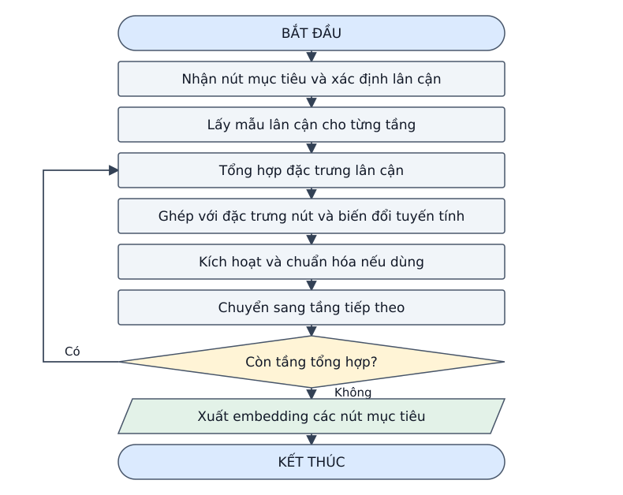

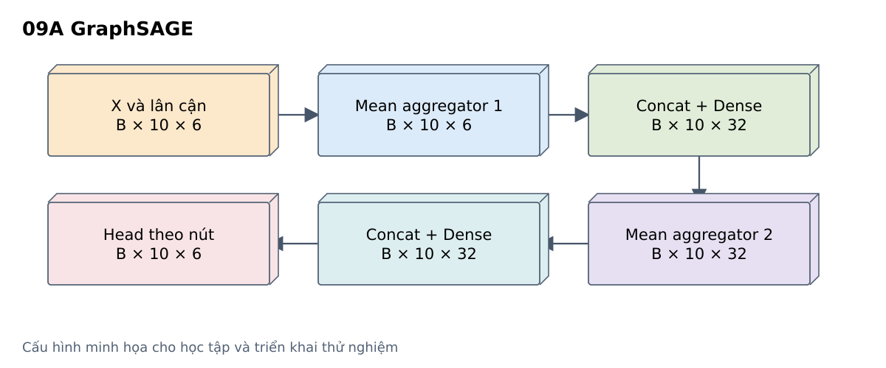

| Khối hoặc lớp | Cấu hình minh họa | Đầu ra |
|---|---|---|
| Đầu vào | N = 10; F = 6 | B × 10 × 6 |
| Lấy mẫu | Tối đa 4 hàng xóm / tầng | Tập lân cận từng nút |
| Mean tầng 1 | Trung bình hàng xóm | B × 10 × 6 |
| Ghép và biến đổi 1 | [6; 6] → 32; ReLU | B × 10 × 32 |
| Mean và ghép tầng 2 | [32; 32] → 32; ReLU | B × 10 × 32 |
| Head theo nút | Dense dùng chung 32 → 6 | B × 10 × 6 |

Nếu nút không có hàng xóm, quy định vector tổng hợp bằng 0. Chuẩn hóa embedding là lựa chọn riêng, không bắt buộc cho mọi biến thể.

[Mô phỏng MP4](../assets/video/09_GraphSAGE.mp4)

**Lưu ý:** AGG có thể là mean, pooling hoặc phương án khác. Khả năng tạo embedding cho trạm mới không tự bảo đảm chất lượng dự báo; cần đánh giá leave one station out và kiểm tra dịch chuyển miền.

Nguồn: [1, 9]

## 2.11 GAT

Phương án đồ thị học trọng số lân cận

Đầu vào: đặc trưng nút và tập cạnh cho phép. Đầu ra: biểu diễn tổng hợp bằng attention.

Attention cho phép cùng một nút sử dụng thông tin từ các hàng xóm với trọng số khác nhau. Có thể dùng nhiều đầu attention để kết hợp các kiểu biểu diễn.

**Kiến trúc:** Biến đổi đặc trưng → điểm attention trên cạnh → softmax → tổng có trọng số.

$$
\alpha_{ij}=\frac{\exp(e_{ij})}{\sum_{k\in N(i)}\exp(e_{ik})},\quad h_i^\prime=\phi(\sum_j\alpha_{ij}Wh_j)
$$

1. Nhận đặc trưng nút và tập cạnh hợp lệ.
2. Biến đổi tuyến tính đặc trưng nút.
3. Tính điểm attention cho từng cạnh.
4. Softmax trong lân cận nút nhận.
5. Tổng hợp thông điệp có trọng số.
6. Kết hợp các đầu và áp dụng kích hoạt.

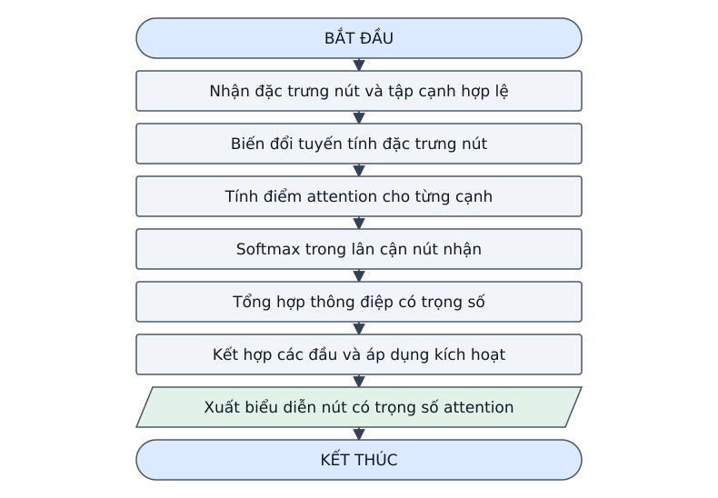

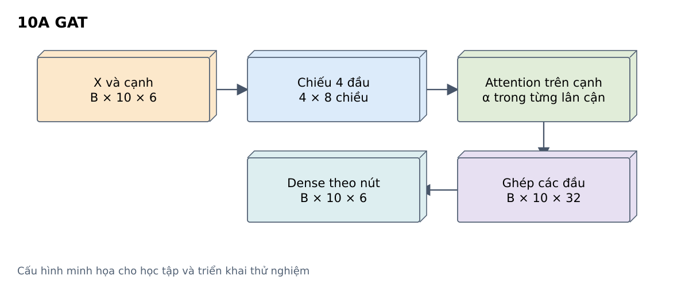

| Khối hoặc lớp | Cấu hình minh họa | Đầu ra |
|---|---|---|
| Đầu vào | N = 10; F = 6; thêm self loop | B × 10 × 6 |
| Chiếu đa đầu | 4 heads; 8 chiều / head | B × 10 × 4 × 8 |
| Điểm cạnh và softmax | Chỉ chuẩn hóa trên hàng xóm | α cho mỗi cạnh và head |
| Tổng hợp và concat | 4 × 8 = 32; ELU | B × 10 × 32 |
| Head theo nút | Dense dùng chung 32 → 6 | B × 10 × 6 |

Cấu hình GAT một tầng minh họa. Với mạng sông, khai báo rõ chiều gửi–nhận và tập cạnh được phép.

[Mô phỏng MP4](../assets/video/10_GAT.mp4)

**Lưu ý:** Chỉ tính trên cạnh được cho phép; muốn có hướng phải xác định đúng nút gửi và nút nhận. Trọng số attention không tự chứng minh quan hệ nhân quả hay lượng nước đóng góp thực tế.

Nguồn: [1, 10]

## 2.12 Transformer

Mô hình nền và encoder chuỗi quan trắc

Đầu vào: chuỗi vector và thông tin vị trí thời gian. Đầu ra: biểu diễn hoặc dự báo đa bước.

Self attention so sánh các thời điểm để kết hợp thông tin theo mức liên quan. Mạng cần thông tin vị trí vì phép attention đơn thuần không xác định thứ tự chuỗi.

**Kiến trúc:** Embedding và thời gian → multi head attention → mạng truyền thẳng và các kết nối dư.

$$
\mathrm{Attention}(Q_a,K,V)=\mathrm{softmax}(Q_aK^T/\sqrt{d_k})V
$$

1. Nhận cửa sổ đầu vào có sẵn tại thời điểm dự báo.
2. Tạo embedding và thêm thông tin vị trí thời gian.
3. Tính các ma trận query key value.
4. Áp dụng mặt nạ phù hợp và attention nhiều đầu.
5. Kết nối dư chuẩn hóa và mạng truyền thẳng.
6. Đưa biểu diễn sang lớp hoặc đầu dự báo.

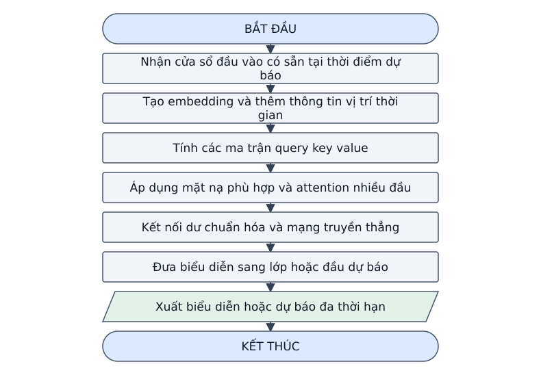

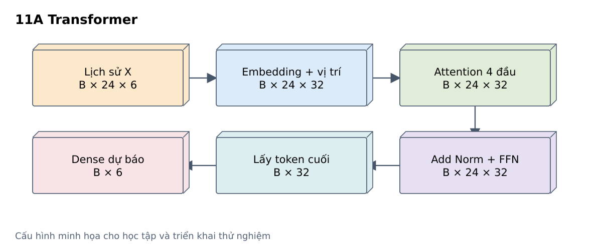

| Khối hoặc lớp | Cấu hình minh họa | Đầu ra |
|---|---|---|
| Đầu vào | L = 24; F = 6 | B × 24 × 6 |
| Embedding và vị trí | Dense 6 → 32 | B × 24 × 32 |
| Self attention | 4 heads; dₖ = 8 | B × 24 × 32 |
| Add Norm và FFN | 32 → 64 → 32; nhánh dư | B × 24 × 32 |
| Lấy token cuối | Chỉ dữ liệu lịch sử đến t | B × 32 |
| Head trực tiếp | Dense 32 → 6 | B × 6 |

Đây là encoder Transformer một khối. Vì mọi token thuộc cửa sổ đã quan trắc, có thể attention toàn lịch sử; decoder tự hồi quy cần causal mask.

[Mô phỏng MP4](../assets/video/11_Transformer.mp4)

**Lưu ý:** Query ký hiệu Q_a để tránh nhầm lưu lượng. Encoder có thể attention toàn bộ cửa sổ lịch sử; decoder tự hồi quy cần causal mask. Không đưa quan trắc tương lai chưa có vào đầu vào.

Nguồn: [1, 11]

## 2.13 TFT

Mô hình nền cho dự báo đa thời hạn

Đầu vào: biến tĩnh, quan trắc lịch sử và biến tương lai đã biết nếu có. Đầu ra: dự báo theo thời hạn.

TFT kết hợp lựa chọn biến, gating, xử lý tuần tự cục bộ và attention dài hạn. Biến tương lai chỉ được dùng nếu thực sự biết tại thời điểm phát báo, như lịch hoặc dự báo ngoại sinh sẵn có.

**Kiến trúc:** Mã hóa tĩnh và chọn biến → LSTM → làm giàu ngữ cảnh → attention → đầu ra phân vị.

$$
\widehat{y}_{t+\Delta}^{(\tau)}=f_{\tau,\Delta}(X_{\leq t},S,U_{known})
$$

1. Phân nhóm biến tĩnh lịch sử và tương lai đã biết.
2. Mã hóa biến tĩnh và thực hiện lựa chọn biến.
3. Xử lý cục bộ bằng lớp hồi tiếp.
4. Làm giàu biểu diễn bằng ngữ cảnh tĩnh.
5. Áp dụng attention theo thời gian và gating.
6. Xuất các phân vị theo từng thời hạn.

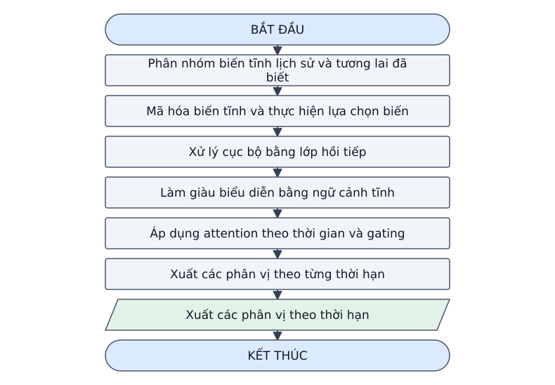

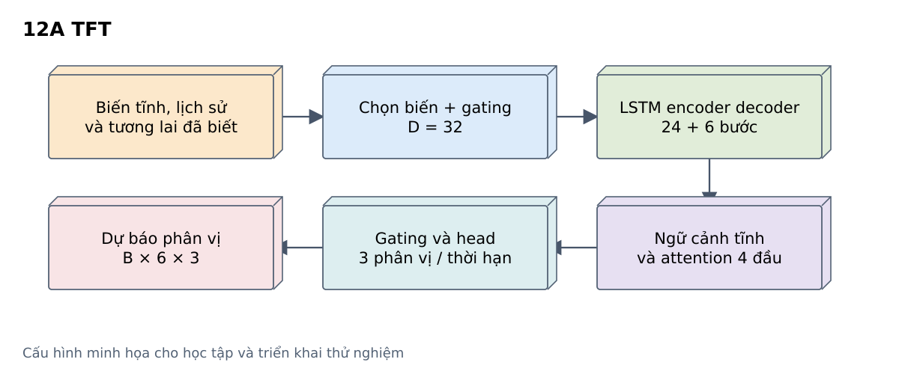

| Khối hoặc lớp | Cấu hình minh họa | Đầu ra |
|---|---|---|
| Ba nhóm đầu vào | Tĩnh 5; lịch sử 24 × 6; lịch 6 × 2 | B × 5; B × 24 × 6; B × 6 × 2 |
| Embedding và chọn biến | D = 32; GRN và gating | B × 24 × 32; B × 6 × 32 |
| LSTM encoder decoder | hidden size = 32 | B × 30 × 32 |
| Làm giàu ngữ cảnh | Ngữ cảnh tĩnh; D = 32 | B × 30 × 32 |
| Attention thời gian | 4 đầu; giữ 6 bước dự báo | B × 6 × 32 |
| Gating và đầu phân vị | τ = 0,1; 0,5; 0,9 | B × 6 × 3 |

Sơ đồ TFT được giản lược. Kích thước khối attention là quy ước minh họa; dùng biến tương lai chỉ khi chúng đã biết tại thời điểm phát báo.

[Mô phỏng MP4](../assets/video/12_TFT.mp4)

**Lưu ý:** Công thức mô tả ánh xạ tổng thể, không thay thế thuật toán đầy đủ của TFT. Gating lựa chọn biến trong TFT không đồng nhất với quality aware adaptive gate của đề cương.

Nguồn: [1, 12]

## 2.14 STGNN có hướng

Thành phần cốt lõi phục vụ RQ2

Đầu vào: chuỗi đa trạm, đồ thị mạng sông và thuộc tính cạnh. Đầu ra: dự báo đa thời hạn tại từng nút.

Mô đun thời gian học diễn biến tại từng trạm. Mô đun đồ thị kết hợp thông tin từ thượng lưu theo cạnh có hướng. Đây là một họ kiến trúc, có thể sắp xếp hoặc đan xen hai phép học.

**Kiến trúc:** Encoder thời gian → truyền tin theo mạng sông → decoder đa thời hạn.

$$
m_{i,t}=\sum_{j\in N_{up}(i)}\psi(u_{j,t},u_{i,t},e_{ji}),\quad z_{i,t}=\phi(u_{i,t},m_{i,t})
$$

1. Dựng đồ thị có hướng và thuộc tính nút cạnh.
2. Mã hóa cửa sổ lịch sử tại từng nút.
3. Tạo thông điệp theo cạnh thượng lưu đến hạ lưu.
4. Tổng hợp thông điệp và cập nhật trạng thái nút.
5. Giải mã theo từng thời hạn dự báo.
6. Xuất Q H hoặc đầu ra xác suất tại nút.

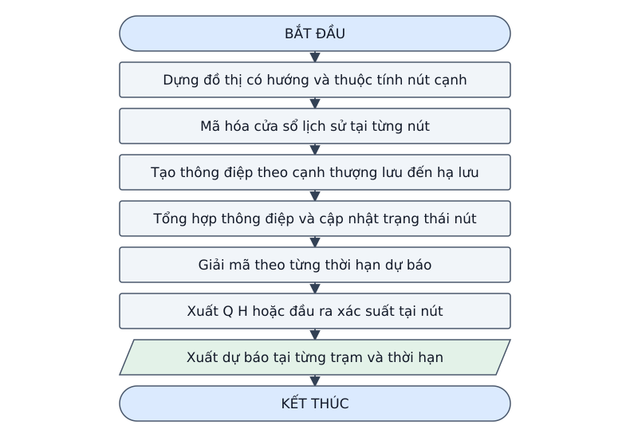

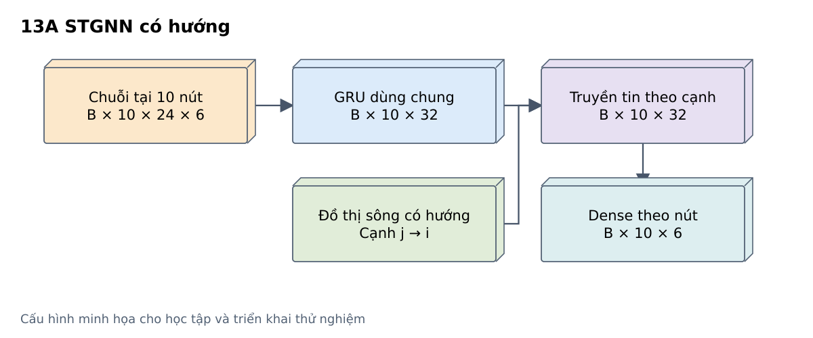

| Khối hoặc lớp | Cấu hình minh họa | Đầu ra |
|---|---|---|
| Chuỗi nhiều nút | N = 10; L = 24; F = 6 | B × 10 × 24 × 6 |
| GRU từng nút | Cùng bộ trọng số; D = 32 | B × 10 × 32 |
| Thuộc tính cạnh | Khoảng cách; độ dốc; độ trễ | E × 3 |
| Message function | MLP: [32; 32; 3] → 32 | B × E × 32 |
| Tổng hợp và cập nhật | Sum hàng xóm vào; [32; 32] → 32 | B × 10 × 32 |
| Head dùng chung | Dense 32 → 6 | B × 10 × 6 |

Đây là phương án mã hóa thời gian rồi truyền tin có hướng. Độ trễ trong thuộc tính cạnh không tự bảo đảm đã mô hình hóa thời gian truyền lũ.

[Mô phỏng MP4](../assets/video/13_STGNN_co_huong.mp4)

**Lưu ý:** Lưu đồ minh họa temporal encoder rồi graph rồi decoder. Graph Convolutional GRU và LSTM kết hợp GNN routing trong tổng quan là các cách ghép liên quan. Cần kiểm chứng riêng hiệu quả của topology và độ trễ truyền.

Nguồn: [1, 13]

## 2.15 Mô hình đa nguồn thích nghi và STGNN đa nhiệm

Kiến trúc tổng thể đề xuất trong RQ1 và RQ2

Đầu vào: các nguồn quan trắc, metadata chất lượng và mạng sông. Đầu ra: Q, H, xác suất vượt ngưỡng và bất định.

Mỗi nguồn được mã hóa bằng một kiến trúc phù hợp rồi chiếu về cùng số chiều. Cổng hợp nhất học mức đóng góp theo mask, tuổi dữ liệu, chất lượng và ngữ cảnh trước khi truyền tin trên mạng sông.

**Kiến trúc:** Encoder từng nguồn → phép chiếu → quality aware gate → STGNN → các đầu đa nhiệm.

$$
\alpha_s=\mathrm{softmax}_s(g([\widetilde{h}_s,M_s,A_s,R_s,c])),\quad z=\sum_s\alpha_s\widetilde{h}_s
$$

1. Nhận dữ liệu từng nguồn và metadata chất lượng.
2. Mã hóa từng nguồn rồi chiếu về cùng số chiều.
3. Tính điểm nguồn theo mask age quality và ngữ cảnh.
4. Chuẩn hóa trọng số và tổng hợp đa nguồn.
5. Truyền tin trên đồ thị mạng sông có hướng.
6. Giải mã đa thời hạn bằng các đầu Q H và cảnh báo.
7. Tính các phân vị hoặc tham số phân phối nếu dùng.

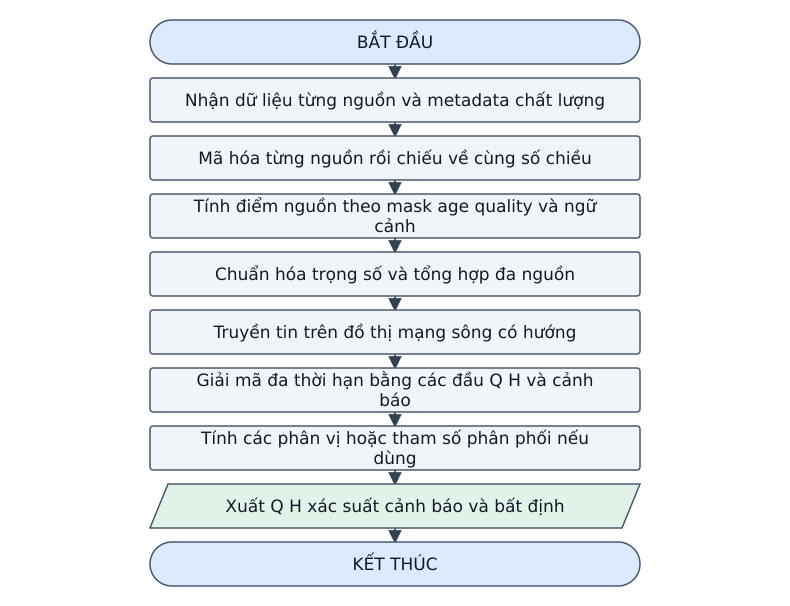

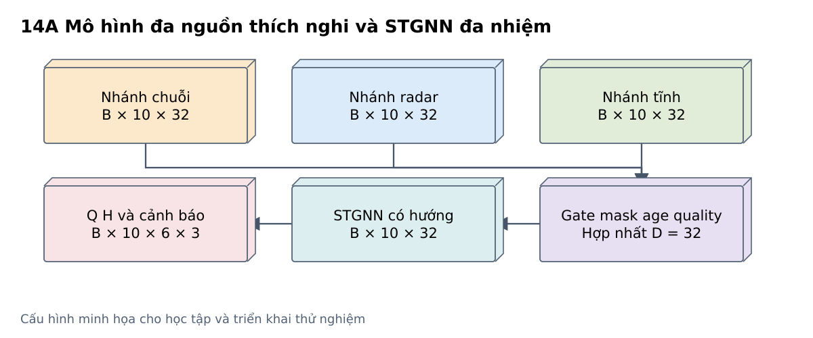

| Khối hoặc lớp | Cấu hình minh họa | Đầu ra |
|---|---|---|
| Chuỗi tại mỗi nút | GRU hidden = 32; L = 24; F = 6 | B × 10 × 32 |
| Chuỗi radar từng vùng | ConvLSTM 32 + global pool | B × 10 × 32 |
| Thuộc tính tĩnh | MLP 5 → 32 | B × 10 × 32 |
| Gate ba nguồn | Mask; age; quality; masked softmax | α: B × 10 × 3 |
| Hợp nhất và đồ thị | Tổng có trọng số; D = 32 | B × 10 × 32 |
| Các head dùng chung | 6 thời hạn; Q, H, p vượt ngưỡng | B × 10 × 6 × 3 |
| Bất định tùy chọn | Head phân vị Q và H; 3 mức | B × 10 × 6 × 2 × 3 |

Kiến trúc là đề xuất minh họa, chưa chốt trong luận án. Nếu mọi nguồn đều không khả dụng, đánh dấu không phát dự báo; không softmax trên toàn bộ giá trị bị loại.

[Mô phỏng MP4](../assets/video/14_Da_nguon_STGNN.mp4)

**Lưu ý:** Chọn encoder theo từng nhánh; không cần xếp tất cả mạng vào một nhánh. Nguồn vắng hoàn toàn cần mask loại trừ rõ ràng và phương án khi không còn nguồn. Đóng góp mới phải được chứng minh bằng baseline và ablation.

Nguồn: [1]

## 3.1 Mixture Density Network

Phương án đầu ra phân phối cho bất định

Đầu vào: biểu diễn từ backbone. Đầu ra: trọng số và tham số các phân phối thành phần.

MDN mô tả nhiều khả năng của đầu ra bằng một hỗn hợp phân phối. Softmax bảo đảm trọng số cộng bằng một; tham số dương dùng phép biến đổi thích hợp. Đề cương chưa chốt họ phân phối.

**Kiến trúc:** Backbone → các đầu tham số hỗn hợp → phân phối có điều kiện.

$$
p(y|x)=\sum_{k=1}^{K}\pi_k(x)p_k(y;\theta_k(x))
$$

1. Nhận biểu diễn từ encoder hoặc STGNN.
2. Tính trọng số hỗn hợp bằng softmax.
3. Tính tham số từng thành phần với ràng buộc phù hợp.
4. Tạo mật độ hỗn hợp có điều kiện.
5. Tối thiểu hóa âm log likelihood khi huấn luyện.
6. Suy ra xác suất vượt ngưỡng hoặc khoảng dự báo.

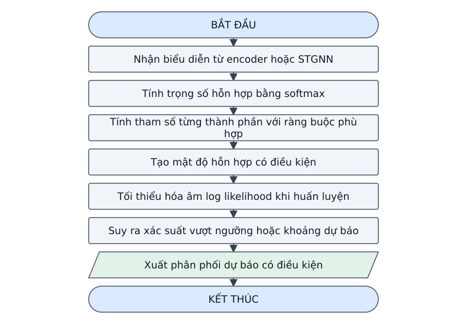

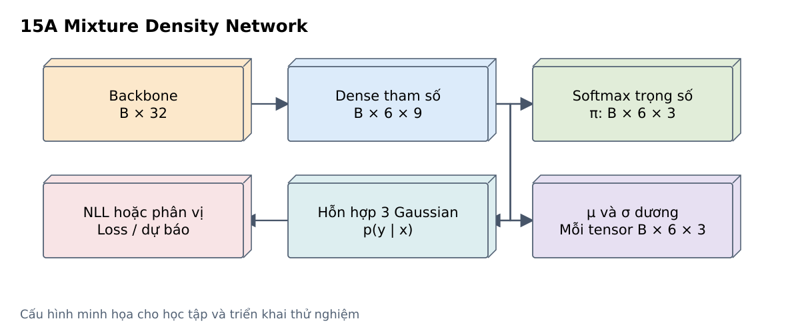

| Khối hoặc lớp | Cấu hình minh họa | Đầu ra |
|---|---|---|
| Biểu diễn đầu vào | D = 32 | B × 32 |
| Dense | 6 × (3 trọng số + 3 μ + 3 σ) | B × 54 |
| Reshape | 6 thời hạn; K = 3 Gaussian | B × 6 × 9 |
| Biến đổi tham số | Softmax π; softplus σ + ε | Ba tensor B × 6 × 3 |
| Hàm mật độ hỗn hợp | Tổng πₖ Normal(μₖ, σₖ) | Mật độ / thời hạn |
| Loss khi train | Âm log likelihood của nhãn hợp lệ | Một số vô hướng |

Phân phối Gaussian chỉ là lựa chọn cho ví dụ, không phải loại phân phối đã được đề cương chốt. Lưu lượng không âm có thể cần phân phối hoặc biến đổi phù hợp.

[Mô phỏng MP4](../assets/video/15_MDN.mp4)

**Lưu ý:** Cần chọn phân phối phù hợp miền giá trị và đặc điểm Q hoặc H. MDN là phương án đầu ra bất định, không phải encoder thay thế trực tiếp cho TCN hay LSTM.

Nguồn: [1, 14]

## 3.2 Dự báo phân vị

Phương án lượng hóa bất định bằng quantile loss

Đầu vào: biểu diễn học được và các mức phân vị. Đầu ra: các phân vị theo từng thời hạn.

Mỗi đầu học một mức phân vị thay vì chỉ giá trị trung bình. Kết hợp các phân vị thấp và cao để tạo khoảng dự báo; cần kiểm soát hiện tượng các phân vị đảo thứ tự.

**Kiến trúc:** Backbone → nhiều đầu phân vị → quantile loss → khoảng dự báo.

$$
\rho_\tau(y-\hat y)=\max\{\tau(y-\hat y),(\tau-1)(y-\hat y)\}
$$

1. Chọn các mức phân vị và thời hạn.
2. Chạy backbone và xuất dự báo từng phân vị.
3. Tính quantile loss trên nhãn hợp lệ.
4. Tổng hợp loss và cập nhật trọng số.
5. Tạo khoảng từ phân vị thấp và cao.
6. Đánh giá độ phủ độ rộng và hiệu chuẩn.

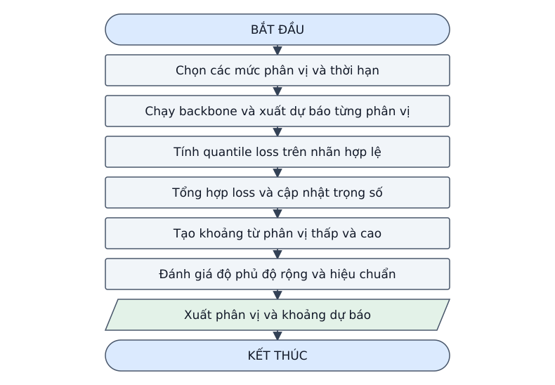

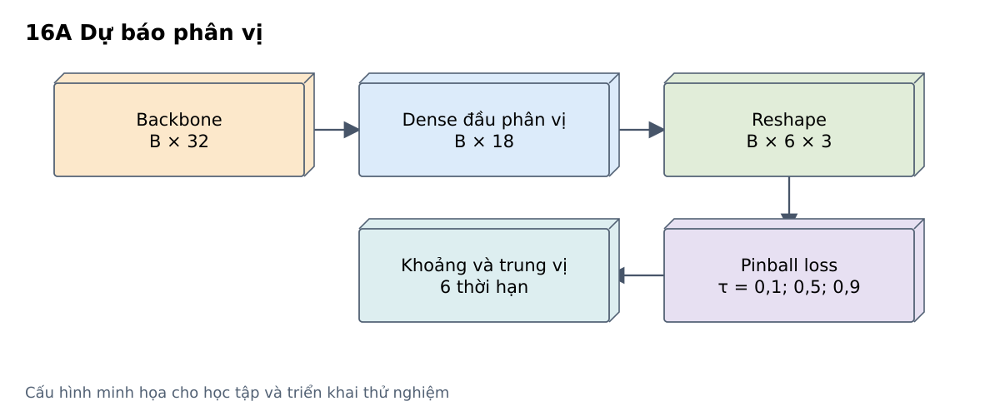

| Khối hoặc lớp | Cấu hình minh họa | Đầu ra |
|---|---|---|
| Biểu diễn backbone | D = 32 | B × 32 |
| Dense trực tiếp | 32 → 18 | B × 18 |
| Reshape | 6 thời hạn × 3 phân vị | B × 6 × 3 |
| Pinball loss | τ = 0,1; 0,5; 0,9; nhãn hợp lệ | Một số vô hướng |
| Đầu ra suy luận | q₀,₁; q₀,₅; q₀,₉ | Khoảng 80% danh nghĩa |

Cần kiểm tra quantile crossing và độ bao phủ thực nghiệm. Khoảng 80% danh nghĩa không mặc nhiên được hiệu chuẩn.

[Mô phỏng MP4](../assets/video/16_Du_bao_phan_vi.mp4)

**Lưu ý:** Ví dụ phân vị 0,05 và 0,95 tạo khoảng dự báo danh định 90 phần trăm; độ phủ thực tế phải được đo. Có thể bổ sung hiệu chuẩn conformal bằng tập riêng.

Nguồn: [1, 12]

## 3.3 Deep ensemble

Phương pháp tổng hợp nhiều mạng để khảo sát bất định mô hình

Đầu vào: tập train và nhiều cấu hình khởi tạo. Đầu ra: tập dự báo và các thống kê tổng hợp.

Các mạng cùng hoặc khác kiến trúc có thể cho dự báo khác nhau vì khởi tạo và quá trình tối ưu khác nhau. Độ phân tán giữa chúng là một chỉ báo về bất định mô hình.

**Kiến trúc:** Huấn luyện nhiều mạng độc lập → dự báo cùng đầu vào → tổng hợp.

$$
\bar y=\frac{1}{M}\sum_{m=1}^{M}\hat y_m
$$

1. Chọn số mô hình và các seed.
2. Huấn luyện từng mô hình chỉ trên train.
3. Chọn checkpoint bằng validation.
4. Chạy cùng đầu vào qua các mô hình đã chọn.
5. Tổng hợp dự báo và tính độ phân tán.
6. Đánh giá hoặc hiệu chuẩn khoảng dự báo.

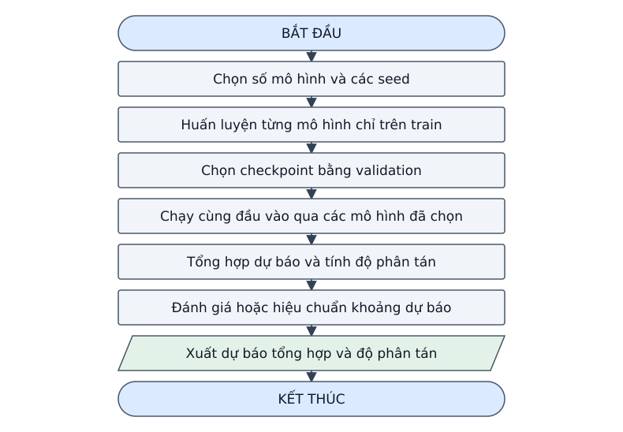

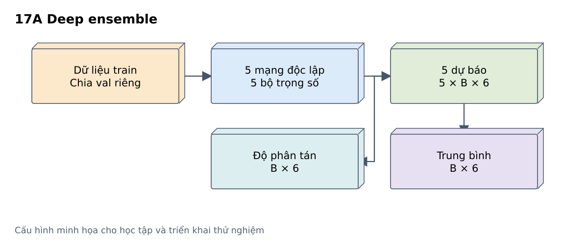

| Khối hoặc lớp | Cấu hình minh họa | Đầu ra |
|---|---|---|
| Mạng thành viên | GRU 32 + Dense 6 | Một dự báo B × 6 |
| Số thành viên | M = 5; khởi tạo seed khác nhau | 5 bộ trọng số |
| Huấn luyện | Mỗi mạng chọn checkpoint riêng | 5 mạng đã fit |
| Suy luận | Chạy từng thành viên | 5 × B × 6 |
| Trung bình | Theo trục thành viên | B × 6 |
| Phương sai mẫu | Chia M − 1; cần M > 1 | B × 6 |

Độ phân tán các dự báo điểm không phải toàn bộ bất định quan trắc. Có thể dùng head phân phối để tách thêm thành phần bất định.

[Mô phỏng MP4](../assets/video/17_Deep_ensemble.mp4)

**Lưu ý:** Nếu mỗi mạng còn xuất phân phối thì tổng hợp cả thành phần bất định trong và giữa các mạng. Phân tán ensemble không tự tạo bảo đảm độ phủ; chi phí tăng theo số mạng.

Nguồn: [1, 14]

## 3.4 Monte Carlo dropout

Phương pháp suy luận lặp với dropout

Đầu vào: mạng được huấn luyện với dropout và một mẫu cần dự báo. Đầu ra: nhiều dự báo ngẫu nhiên.

Mỗi lần suy luận dùng một mẫu dropout, tạo một kết quả hơi khác. Nhiều lần chạy cung cấp ước lượng xấp xỉ độ nhạy dự báo đối với cấu hình mạng bị bỏ ngẫu nhiên.

**Kiến trúc:** Giữ dropout khi suy luận → chạy nhiều lần → tổng hợp trung bình và phân tán.

$$
\widehat{\mathrm{Var}}(y)=\frac{1}{M-1}\sum_{m=1}^{M}(\hat y_m-\bar y)^2
$$

1. Nạp checkpoint và chọn số lần chạy M lớn hơn một.
2. Bật dropout khi suy luận và giữ các lớp khác ở chế độ phù hợp.
3. Chạy suy luận với một mẫu dropout.
4. Lưu kết quả và đổi mẫu dropout.
5. Tổng hợp trung bình phân tán và các phân vị.

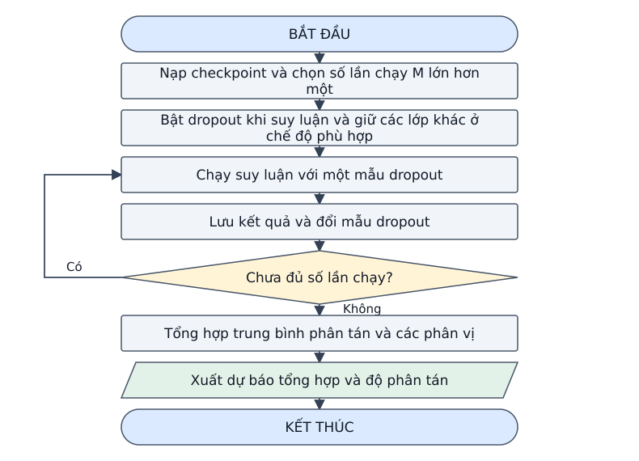

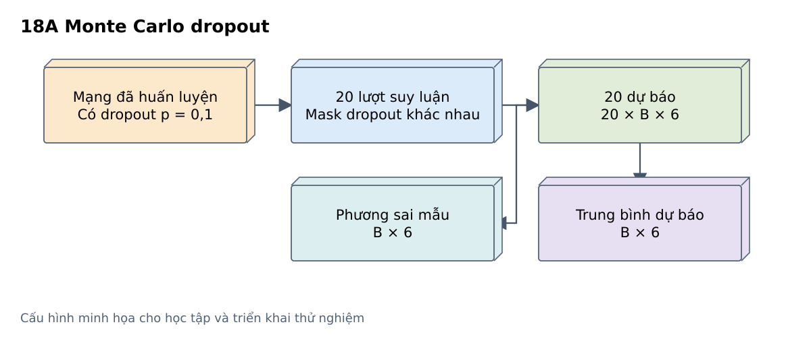

| Khối hoặc lớp | Cấu hình minh họa | Đầu ra |
|---|---|---|
| Backbone minh họa | GRU 32 → dropout → Dense 6 | B × 6 |
| Dropout | p = 0,1 khi train | B × 32 |
| Suy luận MC | Chỉ bật dropout; T = 20 | 20 mask ngẫu nhiên |
| Dự báo lặp | Cùng một đầu vào | 20 × B × 6 |
| Tổng hợp | Mean và phương sai với T − 1 | Mỗi tensor B × 6 |

Khi suy luận chỉ bật các lớp dropout cần thiết; BatchNorm nếu có vẫn dùng thống kê đánh giá. Độ phân tán không mặc nhiên tạo khoảng dự báo đã hiệu chuẩn.

[Mô phỏng MP4](../assets/video/18_MC_dropout.mp4)

**Lưu ý:** Không bật toàn bộ mạng sang train một cách máy móc vì BatchNorm có thể thay đổi hành vi. Khoảng từ các lần chạy cần được kiểm tra hiệu chuẩn; đây là xấp xỉ, không phải hậu nghiệm Bayes chính xác.

Nguồn: [1, 14]

## 3.5 Conformal prediction

Hiệu chuẩn khoảng dự báo sau huấn luyện

Đầu vào: mô hình đã chốt, calibration set và mức sai số alpha. Đầu ra: khoảng đã hiệu chuẩn.

Lưu đồ minh họa split conformal cho dự báo điểm. Với từng thời hạn, tính sai số tuyệt đối trên calibration rồi dùng phân vị hiệu chỉnh hữu hạn mẫu để mở rộng khoảng.

**Kiến trúc:** Dự báo calibration → điểm sai lệch → phân vị hiệu chuẩn → khoảng cho mẫu mới.

$$
C(x)=[\hat y(x)-q,\hat y(x)+q],\quad k=\lceil(n+1)(1-\alpha)\rceil
$$

1. Khóa mô hình và chọn calibration độc lập với train.
2. Tính dự báo và sai số tuyệt đối trên calibration.
3. Tính chỉ số phân vị hữu hạn mẫu theo alpha.
4. Lấy ngưỡng sai số cho từng thời hạn.
5. Dự báo điểm cho mẫu mới.
6. Tạo khoảng đối xứng bằng ngưỡng hiệu chuẩn.

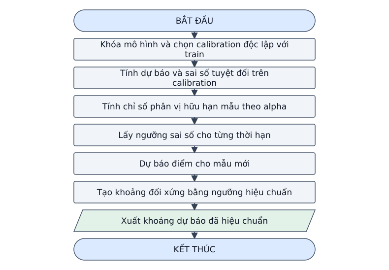

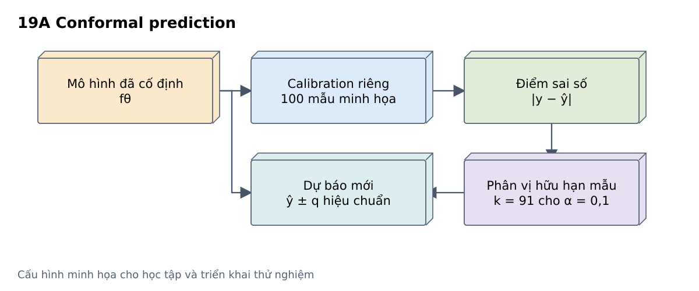

| Khối hoặc lớp | Cấu hình minh họa | Đầu ra |
|---|---|---|
| Mô hình điểm | Đã chọn bằng train và validation | fθ cố định |
| Calibration | n = 100 nhãn hợp lệ / thời hạn | 100 sai số / thời hạn |
| Nonconformity score | |y − ŷ| | n giá trị không âm |
| Chỉ số phân vị | ceil((n + 1)(1 − α)); α = 0,1 | k = 91 |
| Ngưỡng hiệu chuẩn | Phần tử thứ 91 theo thứ tự tăng | q cho từng thời hạn |
| Khoảng mới | [ŷ − q; ŷ + q] | B × 6 × 2 |

Split conformal minh họa cho từng thời hạn, không bảo đảm đồng thời cả quỹ đạo. Bao phủ hữu hạn mẫu dựa trên điều kiện trao đổi; chuỗi lũ có thể vi phạm điều kiện này.

[Mô phỏng MP4](../assets/video/19_Conformal.mp4)

**Lưu ý:** q là phần tử thứ k của điểm calibration đã sắp xếp; nếu k vượt n, dùng quy ước ngưỡng vô hạn hoặc tăng cỡ mẫu. Bảo đảm chuẩn cần tính trao đổi; chuỗi thủy văn phụ thuộc hoặc lệch miền không tự thỏa điều kiện này.

Nguồn: [1, 15]

## 4.1 Source dropout

Kỹ thuật huấn luyện chịu mất nguồn

Đầu vào: một mini batch đa nguồn. Đầu ra: dự báo và loss khi một phần nguồn bị che.

Thay vì chỉ bỏ các nơ ron, source dropout bỏ cả nguồn trong cửa sổ huấn luyện. Curriculum có thể tăng dần mức hoặc độ dài mất nguồn theo các kịch bản có cơ sở.

**Kiến trúc:** Lấy mẫu nguồn bị bỏ → cập nhật mask → mô hình đa nguồn → cập nhật tham số.

$$
\mathcal L_{drop}=\mathcal L(f_\theta(X\odot D,M_D),y)
$$

1. Lấy mini batch đa nguồn và metadata.
2. Lấy mẫu kịch bản mất nguồn phù hợp.
3. Che nguồn và cập nhật mặt nạ cùng metadata.
4. Kiểm tra còn nguồn theo quy tắc vận hành.
5. Chạy encoder gate và mô hình dự báo.
6. Tính loss rồi lan truyền ngược.

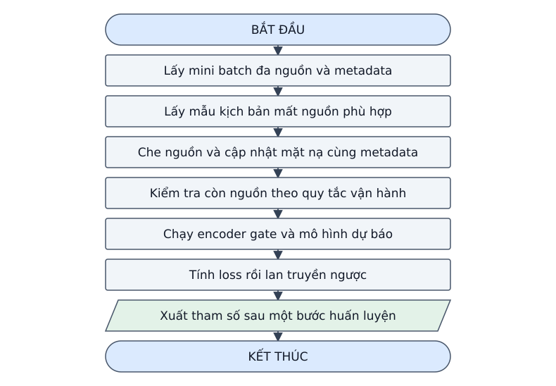

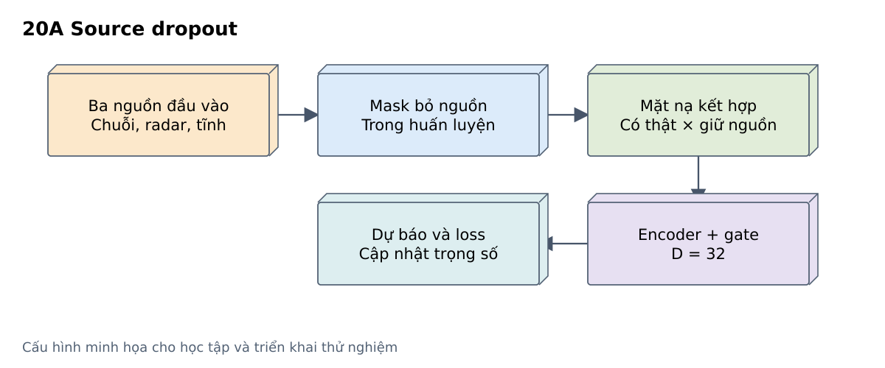

| Khối hoặc lớp | Cấu hình minh họa | Đầu ra |
|---|---|---|
| Ba nguồn | M = 3 nguồn; mask có thật | B × 3 mask |
| Drop nguồn train | p bỏ = 0,2; Bernoulli / mẫu / nguồn | Mask giữ B × 3 |
| Kết hợp mask | Mhiệu lực = Mcó thật × Mgiữ | B × 3 |
| Tránh tất cả bị bỏ | Giữ lại ít nhất 1 nguồn đang có | Mask hợp lệ |
| Mã hóa và hợp nhất | Các embedding D = 32; gate | B × 32 |
| Head và loss | 6 thời hạn; mask nhãn | B × 6 và loss |

Chỉ áp dụng source dropout nhân tạo khi huấn luyện. Nếu đầu vào vốn thiếu toàn bộ nguồn, đánh dấu không khả dụng thay vì cố tạo nguồn mới.

[Mô phỏng MP4](../assets/video/20_Source_dropout.mp4)

**Lưu ý:** Cần quy định rõ trường hợp mất mọi nguồn: dùng nguồn nền hợp lệ, mô hình dự phòng hoặc báo thiếu điều kiện. Kịch bản mô phỏng phải phân biệt mất nguồn với mất vài giá trị.

Nguồn: [1]

## 4.2 Consistency training

Điều chuẩn nhất quán trước thiếu hoặc nhiễu

Đầu vào: hai phiên bản cùng cửa sổ và cùng nhãn. Đầu ra: loss giám sát cộng điều chuẩn.

Mô hình được khuyến khích đưa ra dự báo gần nhau khi thông tin bị suy giảm có kiểm soát. Cả hai phiên bản phải tuân thủ thông tin sẵn có tại thời điểm dự báo.

**Kiến trúc:** Nhánh đầy đủ và nhánh bị che → hai dự báo → loss giám sát và nhất quán.

$$
\mathcal L=\mathcal L_{sup}+\lambda\,d(f_\theta(X),f_\theta(\widetilde X))
$$

1. Lấy cửa sổ quan trắc và nhãn hợp lệ.
2. Tạo phiên bản đầy đủ và phiên bản che hoặc nhiễu.
3. Dự báo cả hai phiên bản bằng mạng dùng chung hoặc teacher.
4. Tính loss giám sát và khoảng cách giữa dự báo.
5. Kết hợp hai loss với hệ số điều chuẩn.
6. Cập nhật tham số theo thiết kế gradient.

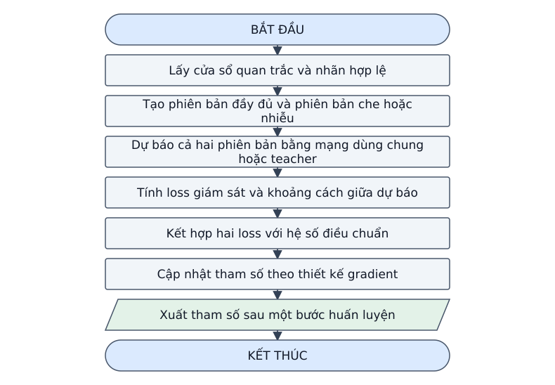

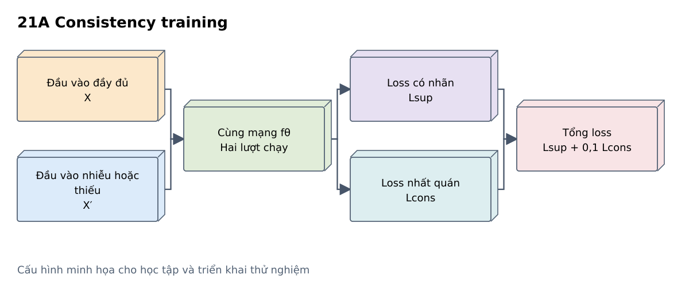

| Khối hoặc lớp | Cấu hình minh họa | Đầu ra |
|---|---|---|
| Nhánh tham chiếu | X có các nguồn đang khả dụng | Ŷ = fθ(X) |
| Nhánh biến đổi | Bỏ nguồn hoặc thêm nhiễu | Ŷ′ = fθ(X′) |
| Backbone | Chia sẻ cùng tham số θ | Mỗi dự báo B × 6 |
| Loss giám sát | Hai nhánh nếu có nhãn hợp lệ | Lsup |
| Loss nhất quán | Mean squared difference trên cặp hợp lệ | Lcons |
| Loss kết hợp | λcons = 0,1 minh họa | Một số vô hướng |

Ví dụ dùng hai nhánh chia sẻ tham số và cho gradient qua cả hai. Teacher EMA hoặc stop gradient là các biến thể khác; cần chỉ rõ nếu dùng.

[Mô phỏng MP4](../assets/video/21_Consistency_training.mp4)

**Lưu ý:** Cần chốt khoảng cách d, hệ số lambda và có stop gradient ở nhánh tham chiếu hay không. Không ép hai dự báo bằng nhau khi biến đổi đã làm mất thông tin quyết định mà không xét mức độ tin cậy.

Nguồn: [1]

## 4.3 Transfer learning

Chuyển giao từ dữ liệu mở sang Lạng Sơn

Đầu vào: dữ liệu nguồn và train địa phương. Đầu ra: mô hình tinh chỉnh và kết quả test địa phương.

Pretraining học biểu diễn trên nhiều trạm hoặc lưu vực. Fine tuning thích nghi với đặc điểm địa phương. Phải so sánh với huấn luyện từ đầu dưới cùng ngân sách và cách chia dữ liệu.

**Kiến trúc:** Pretrain → chuyển trọng số → fine tune → hiệu chuẩn → test địa phương.

$$
\theta_{LS}\leftarrow\mathrm{FineTune}(\theta_{pre},\mathcal D_{LS,train})
$$

1. Chốt train validation calibration và test địa phương.
2. Pretrain trên dữ liệu nguồn hợp lệ.
3. Chuyển trọng số và chọn phần đóng băng hoặc tinh chỉnh.
4. Fine tune bằng train và chọn bằng validation địa phương.
5. Hiệu chuẩn bằng tập calibration địa phương.
6. Đánh giá test khóa và so sánh train from scratch.

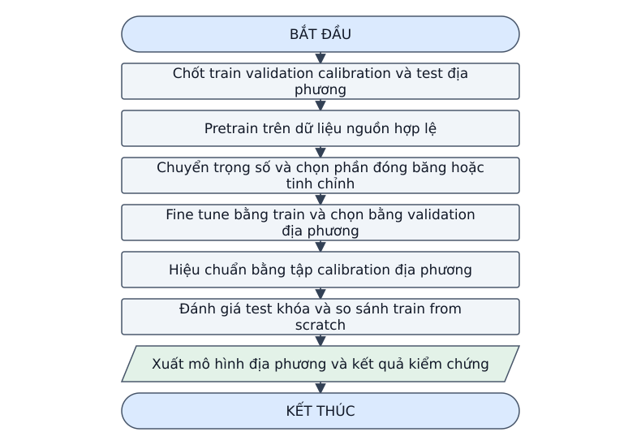

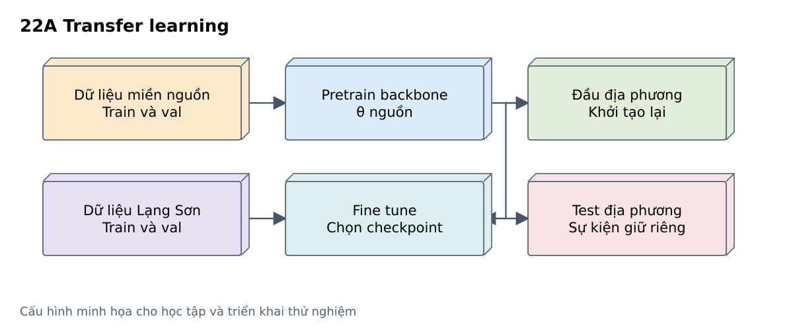

| Khối hoặc lớp | Cấu hình minh họa | Đầu ra |
|---|---|---|
| Mô hình nguồn | GRU 32 + head phù hợp | θ nguồn |
| Chuyển trọng số | Giữ encoder nếu biến tương thích | Encoder khởi tạo tốt |
| Head địa phương | Dense 32 → 6; khởi tạo mới | B × 6 |
| Warm up | Tạm đóng băng encoder nếu cần | Chỉ cập nhật head |
| Fine tune | Mở encoder; LR minh họa 0,0001 | θ địa phương |
| Test | Các sự kiện chưa dùng chọn mô hình | Chỉ số dự báo |

Chuẩn hóa địa phương fit bằng train địa phương, và phải kiểm tra tương thích đơn vị, tần suất cùng định nghĩa biến. Đánh giá negative transfer với mô hình train từ đầu.

[Mô phỏng MP4](../assets/video/22_Transfer_learning.mp4)

**Lưu ý:** Không dùng test địa phương để chuẩn hóa, chọn siêu tham số hay hiệu chuẩn. Khi chuyển từ ngày sang giờ hoặc khác biến đầu vào, cần kiểm tra tương thích trước khi tái sử dụng trọng số.

Nguồn: [1]

## 4.4 Học có hướng dẫn vật lý

Ràng buộc miền và mở rộng residual có điều kiện

Đầu vào: dự báo mạng và các ràng buộc miền. Đầu ra: dự báo đã ràng buộc hoặc loss bổ sung.

Đề cương ưu tiên topology sông, quan hệ dự báo với ngưỡng và thứ tự xác suất cảnh báo. Physics guided residual là mở rộng có điều kiện, chưa phải mô hình đã chốt.

**Kiến trúc:** Mô hình dữ liệu → kiểm tra ràng buộc → loss hoặc tham số hóa phù hợp.

$$
\mathcal L=\mathcal L_{data}+\lambda_{phys}\mathcal L_{phys}
$$

1. Xác định ràng buộc có căn cứ và miền áp dụng.
2. Tạo dự báo bằng mô hình học sâu.
3. Áp dụng tham số hóa hoặc tính độ vi phạm.
4. Kết hợp loss dữ liệu và loss ràng buộc.
5. Cập nhật tham số.
6. Kiểm tra hiệu năng và vi phạm trên dữ liệu độc lập.

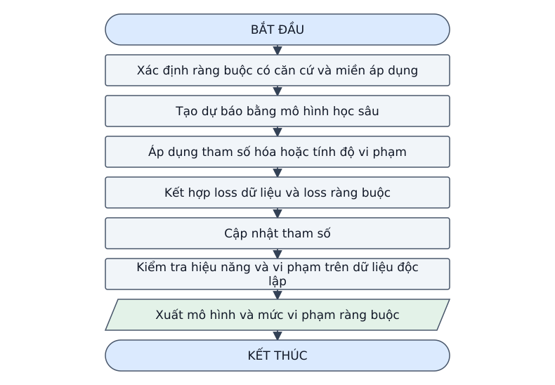

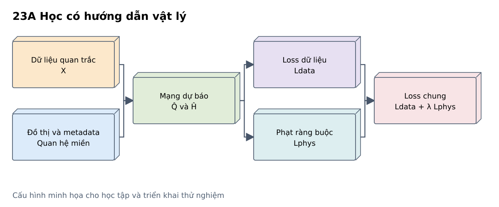

| Khối hoặc lớp | Cấu hình minh họa | Đầu ra |
|---|---|---|
| Backbone | Encoder + đồ thị có hướng | Biểu diễn B × N × 32 |
| Head Q và H | 6 thời hạn; 2 đại lượng | B × N × 6 × 2 |
| Loss dữ liệu | Sai số theo nhãn hợp lệ | Ldata |
| Ví dụ ràng buộc Q | Mean ReLU(−Q̂), sau đổi về đơn vị gốc | Lnonneg |
| Trọng số ràng buộc | λ = 0,1 chỉ để minh họa | Ldata + λ Lnonneg |
| Đánh giá | Sai số và mức vi phạm ràng buộc | Hai nhóm chỉ số |

Mực nước có thể âm so với mốc, nên không áp đặt H ≥ 0 tùy tiện. Bảo toàn khối lượng cần đủ thông tin dòng vào, dòng ra và trữ lượng; ví dụ này chỉ phạt Q âm.

[Mô phỏng MP4](../assets/video/23_Physics_guided.mp4)

**Lưu ý:** Có thể ràng buộc Q không âm; mực nước phải theo mốc cao độ quy ước, không mặc nhiên không âm. Luồng thông tin có hướng không tự bảo đảm bảo toàn khối lượng. Cần ablation để chứng minh lợi ích.

Nguồn: [1]

## 4.5 Mask aware encoder

Biểu diễn có nhận biết tình trạng thiếu dữ liệu

Đầu vào: giá trị, mặt nạ, tuổi dữ liệu và chất lượng. Đầu ra: biểu diễn nguồn có ngữ cảnh thiếu.

Encoder được cung cấp thông tin để phân biệt giá trị bằng không thực với giá trị tạm thay do thiếu. Mặt nạ cần đi cùng phép tổng hợp và hàm mất mát phù hợp.

**Kiến trúc:** Giá trị thay thế hữu hạn và metadata → encoder có xét mask → biểu diễn.

$$
h_s=E_s([X_s^*,M_s,A_s,R_s])
$$

1. Nhận dữ liệu thô và xác định mask hợp lệ.
2. Tạo giá trị thay thế hữu hạn bằng thông tin cho phép.
3. Ghép mask tuổi dữ liệu và chỉ báo chất lượng.
4. Chạy encoder và phép tổng hợp có xét mask.
5. Đánh dấu nguồn vắng hoàn toàn.
6. Xuất biểu diễn cùng trạng thái khả dụng.

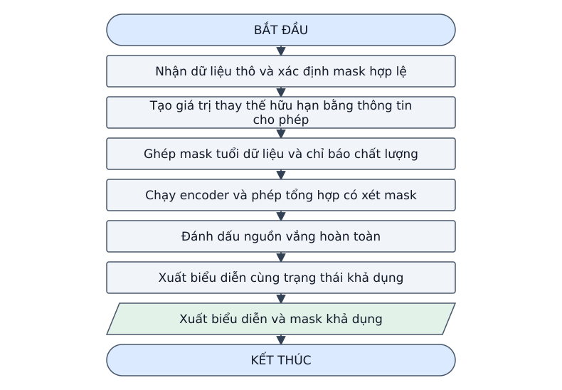

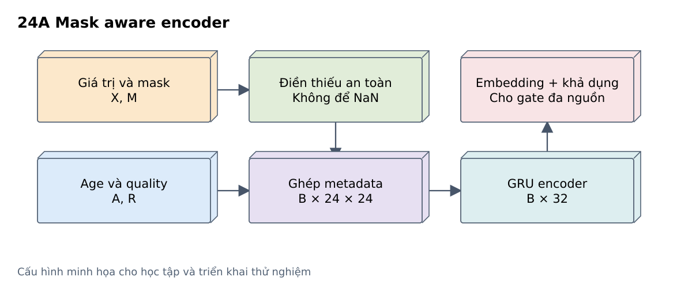

| Khối hoặc lớp | Cấu hình minh họa | Đầu ra |
|---|---|---|
| Dữ liệu X, M, A, R | Mỗi nhóm gồm 6 biến; L = 24 | 4 tensor B × 24 × 6 |
| Giá trị thay thế | where(M, X, 0) sau chuẩn hóa | B × 24 × 6 |
| Ghép theo đặc trưng | 6 giá trị + 6 mask + 6 age + 6 quality | B × 24 × 24 |
| GRU minh họa | input size = 24; hidden = 32 | B × 24 × 32 |
| Lấy trạng thái cuối | Embedding D = 32 | B × 32 |
| Khả dụng nguồn | Có ít nhất một quan trắc dùng được | B × 1 Boolean |

Đây là ví dụ encoder nhận metadata, không phải kiến trúc chuẩn duy nhất. Dùng where để xử lý NaN; phép nhân 0 × NaN vẫn có thể tạo NaN.

[Mô phỏng MP4](../assets/video/24_Mask_aware_encoder.mp4)

**Lưu ý:** Công thức là một cách triển khai minh họa, không phải định nghĩa duy nhất. Đưa mask vào mạng không tự bảo đảm nguồn bị thiếu nhận trọng số bằng không; cần cơ chế loại trừ ở gate khi cần.

Nguồn: [1, 6]

## 4.6 Robust loss và loss mask

Huấn luyện khi có ngoại lai hoặc nhãn thiếu

Đầu vào: dự báo, nhãn và mặt nạ nhãn. Đầu ra: loss chỉ tính trên nhãn hợp lệ.

Huber loss dùng phạt bậc hai với sai số nhỏ và tăng tuyến tính với sai số lớn. Loss mask loại phần tử không có nhãn khỏi tổng và mẫu số; không được coi nhãn thiếu là giá trị bằng không.

**Kiến trúc:** Sai số → Huber loss hoặc loss phù hợp → áp dụng mask → tổng hợp.

$$
\mathcal L=\frac{\sum_i m_i\ell_\delta(y_i-\hat y_i)}{\sum_i m_i},\quad \sum_i m_i>0
$$

1. Nhận dự báo nhãn và mặt nạ nhãn.
2. Kiểm tra số nhãn hợp lệ và bỏ batch nếu bằng không.
3. Tính sai số tại phần tử có nhãn.
4. Dùng Huber loss theo ngưỡng delta.
5. Áp dụng trọng số nhiệm vụ và thời hạn nếu có.
6. Chia tổng loss cho số nhãn hợp lệ lớn hơn không.

| Khối hoặc lớp | Cấu hình minh họa | Đầu ra |
|---|---|---|
| Đầu vào | Ŷ, Y, M: B × 6 | Các cặp ứng viên |
| Chọn nhãn hợp lệ | Boolean indexing trước tính residual | nvalid cặp |
| Huber loss | δ = 1 trên thang chuẩn hóa | nvalid giá trị |
| Miền bậc hai | 0,5 r² nếu |r| ≤ δ | Mỗi phần tử |
| Miền tuyến tính | δ(|r| − 0,5δ) nếu |r| > δ | Mỗi phần tử |
| Tổng hợp | Sum / nvalid; chỉ khi nvalid > 0 | Loss vô hướng |
| Nếu nvalid = 0 | Bỏ bước optimizer của batch | Không chia cho 0 |

Mask nhãn khác mask đầu vào. Robust loss giảm ảnh hưởng residual lớn nhưng không tự phân biệt nhiễu cảm biến với đỉnh lũ thật.

[Mô phỏng MP4](../assets/video/25_Robust_loss.mp4)

**Lưu ý:** Không tự loại hoặc giảm trọng số mọi đỉnh lũ lớn vì đó có thể là cực trị thật. Chọn delta bằng validation và báo cáo riêng sai số đỉnh; có thể kết hợp trọng số sự kiện theo đề cương.

Nguồn: [1]

## Tài liệu tham khảo

[1] Trần Nguyên Hoàng. Đề cương luận án tiến sĩ LATS V2 final. Ngành Khoa học máy tính 9480101. Bản PDF được cung cấp. Xem mục 3.1 và 4.2.3 đến 4.2.6, trang in 5–6 và 15–19.

[2] PyTorch. Conv2d documentation. https://docs.pytorch.org/docs/stable/generated/torch.nn.Conv2d.html

[3] Bai S, Kolter J Z, Koltun V. An Empirical Evaluation of Generic Convolutional and Recurrent Networks for Sequence Modeling. 2018. https://arxiv.org/abs/1803.01271

[4] PyTorch. GRU documentation. https://docs.pytorch.org/docs/stable/generated/torch.nn.GRU.html

[5] PyTorch. LSTM documentation. https://docs.pytorch.org/docs/stable/generated/torch.nn.LSTM.html

[6] Che Z, Purushotham S, Cho K, Sontag D, Liu Y. Recurrent Neural Networks for Multivariate Time Series with Missing Values. Scientific Reports 8, 6085, 2018. DOI 10.1038/s41598-018-24271-9.

[7] Shi X và cộng sự. Convolutional LSTM Network A Machine Learning Approach for Precipitation Nowcasting. 2015. https://arxiv.org/abs/1506.04214

[8] Kipf T N, Welling M. Semi-Supervised Classification with Graph Convolutional Networks. ICLR 2017. https://arxiv.org/abs/1609.02907

[9] Hamilton W L, Ying R, Leskovec J. Inductive Representation Learning on Large Graphs. NeurIPS 2017. https://arxiv.org/abs/1706.02216

[10] Veličković P và cộng sự. Graph Attention Networks. ICLR 2018. https://arxiv.org/abs/1710.10903

[11] Vaswani A và cộng sự. Attention Is All You Need. NeurIPS 2017. https://arxiv.org/abs/1706.03762

[12] Lim B, Arik S O, Loeff N, Pfister T. Temporal Fusion Transformers for Interpretable Multi-horizon Time Series Forecasting. International Journal of Forecasting, 2021. https://arxiv.org/abs/1912.09363

[13] Seo Y, Defferrard M, Vandergheynst P, Bresson X. Structured Sequence Modeling with Graph Convolutional Recurrent Networks. 2016. https://arxiv.org/abs/1612.07659

[14] Klotz D và cộng sự. Uncertainty estimation with deep learning for rainfall–runoff modeling. HESS 26, 1673–1693, 2022. DOI 10.5194/hess-26-1673-2022.

[15] Angelopoulos A N, Bates S. Conformal Prediction A Gentle Introduction. Foundations and Trends in Machine Learning 16, 494–591, 2023. DOI 10.1561/2200000101.